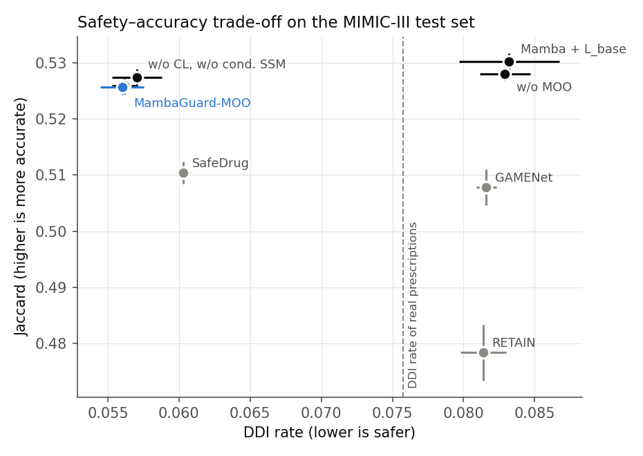
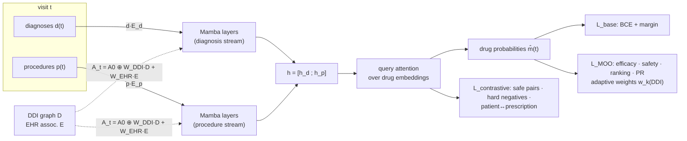
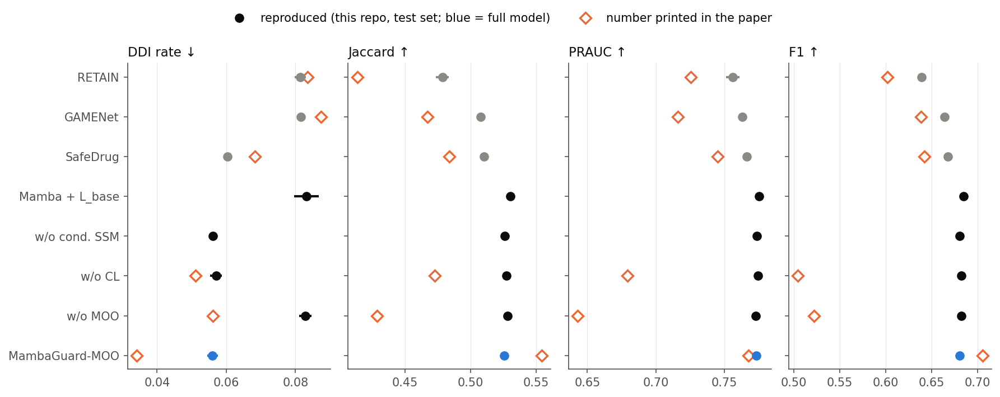
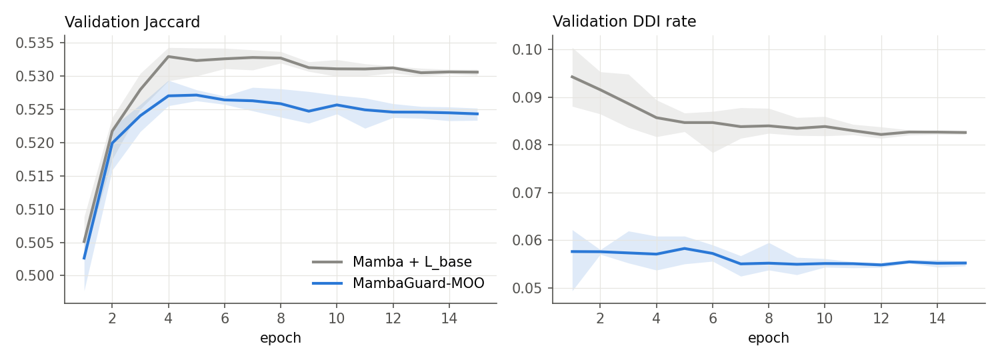

<div align="center">

# MambaGuard-MOO

### Multi-Objective Safe Drug Recommendation with Contrastive Learning

**Hongtao Xie** · **Shengxin Zhu**

<a href="#-citation"></a>




*Test-set safety vs. accuracy. The multi-objective losses cut the DDI rate of the recommended drug sets by a third, to well below that of the real prescriptions, while keeping Jaccard within half a point of the unconstrained model. Grey: official SafeDrug, GAMENet and RETAIN code re-run on the same data.*

</div>

---

## 📖 Abstract

A drug recommender has to do two things at once: suggest the drugs a patient actually needs, and avoid combinations that interact badly. Optimising only the first gives you accurate but risky prescriptions. Optimising only the second gives you safe but useless ones. 💊⚖️

MambaGuard-MOO treats this as an explicit **multi-objective** problem on top of a Mamba sequence model over a patient's visit history:

- 🐍 **Safety-aware state space model.** Diagnoses and procedures of each visit go through two selective state-space (Mamba) streams. The state-transition matrix is modulated per visit by the drug–drug-interaction (DDI) graph and the diagnosis→drug associations mined from the EHR.
- 🎯 **Multi-objective optimisation.** Efficacy, DDI/EHR safety, ranking and precision–recall losses are combined with **adaptive weights** that react to the current DDI rate, and are phased in by a three-stage schedule.
- 🧲 **Contrastive drug embeddings.** Drugs that are safely co-prescribed are pulled together, therapeutically similar but interacting drugs are pushed apart, and the patient representation is aligned with its prescription.

This repository is a **full re-implementation and re-run** of the paper. The original code was lost with an old laptop, so everything here was rebuilt from the paper, trained again on a GPU cluster with 5 seeds per setting, and compared with the official implementations of SafeDrug, GAMENet, RETAIN and LEAP run on exactly the same data. 🔍

## 🧠 Method



| Component | Description | Code |
|---|---|---|
| **Visit encoder** (Eq. 2–3, 7–8) | Multi-hot diagnosis/procedure vectors times learnable tables (`dim = 128`). Each stream has 2 layers `LN(Drop(Mamba(x)) + x)` + FFN. Mamba is a selective scan (S6, `d_state = 16`, conv 4, expand 2) written in plain PyTorch, so no CUDA extension needs to be built. | [`mambaguard/mamba.py`](mambaguard/mamba.py) |
| **Safety-conditioned transitions** (Eq. 6) | `A_t = −exp(A_log + tanh(W_DDI c^ddi_t + W_EHR c^ehr_t))`, with `c^ehr_t = d_t E / |d_t|` (EHR-implied drug distribution, `E = P(drug | diagnosis)` from the training split) and `c^ddi_t = c^ehr_t D` (its expected DDI exposure). `W_DDI`, `W_EHR` are zero-initialised, so training starts from vanilla Mamba and `A_t` stays negative, which keeps the scan stable. | [`mambaguard/mamba.py`](mambaguard/mamba.py), [`mambaguard/model.py`](mambaguard/model.py) |
| **Prescription module** | `[h_d; h_p]` → query, 4-head attention over the drug embeddings `E_drug`, logits `= W_o r · E_drugᵀ + b + s · (d W_effᵀ)/|d|`. | [`mambaguard/model.py`](mambaguard/model.py) |
| **MOO loss** (Eq. 10–15, 23–25) | Efficacy `MSE(σ(W_eff[m, d]), τ)` (τ = 0.9 for target drugs, 0.05 otherwise). Safety = soft DDI rate `m̂ᵀDm̂ / m̂ᵀ(11ᵀ−I)m̂` + 0.1 × the same rate on drug pairs never co-prescribed in the training EHR. Pairwise ranking hinge (γ = 0.1). Soft precision/recall (α = 0.5). Weights `w_k = w⁰_k · max(0, 1 + ρ_k (DDI_ema − 0.06))`, with ρ = +20 for safety and −5 for the others. | [`mambaguard/losses.py`](mambaguard/losses.py) |
| **Contrastive loss** (Eq. 16–18, 26) | Projection `z = W_proj ReLU(W_1 e)`. InfoNCE (τ = 0.1) over *safe* pairs (co-prescribed with lift > 1, ≥ 5 times, no DDI; 3 374 pairs). Hinge `max(0, μ + sim)` on *hard negatives* (DDI pairs in the same ATC-2 class or co-prescribed; 268 pairs). `L_enhanced`: patient↔prescription-centroid InfoNCE with in-batch negatives. | [`mambaguard/losses.py`](mambaguard/losses.py) |
| **Training** (Eq. 19, 27–31) | `L = L_base + λ_MOO L_MOO + λ_CL L_CL` (λ = 1, 0.1). λ_MOO ramps up linearly over epoch 1. λ_CL ramps up as `1 − exp(−t/τ_ramp)`. From epoch 6, weights of objectives whose validation metric got worse are boosted (Eq. 29). Model selection keeps the best `J + PRAUC + 0.5(1 − DDI)` on validation, preferring epochs with DDI ≤ 0.06. AdamW, lr 1e-3, cosine schedule, 15 epochs, batch 16 patients. | [`train.py`](train.py) |

## 📊 Results

MIMIC-III, SafeDrug preprocessing and split (4 233 / 1 059 / 1 058 patients for train / val / test, 112 ATC-3 drug classes). The test protocol matches SafeDrug's: metrics averaged per patient, mean of 10 bootstrap samples of 80 % of the test patients. The ± values below are **std over 5 training seeds**.

<!--MAIN_TABLE-->
| Method | DDI Rate ↓ | Jaccard ↑ | PRAUC ↑ | F1 ↑ | Avg. #Med |
|---|---|---|---|---|---|
| RETAIN (official code, 1 run, bootstrap std) | 0.0814 ± 0.0016 | 0.4784 ± 0.0050 | 0.7561 ± 0.0050 | 0.6392 ± 0.0045 | 19.8090 ± 0.2338 |
| GAMENet (official code, 1 run, bootstrap std) | 0.0816 ± 0.0007 | 0.5078 ± 0.0032 | 0.7630 ± 0.0017 | 0.6640 ± 0.0029 | 26.0182 ± 0.1305 |
| SafeDrug (official code, 1 run, bootstrap std) | 0.0603 ± 0.0005 | 0.5104 ± 0.0020 | 0.7663 ± 0.0029 | 0.6675 ± 0.0020 | 20.4335 ± 0.1532 |
| Mamba backbone + L_base only (5 seeds) | 0.0832 ± 0.0035 | 0.5302 ± 0.0015 | 0.7754 ± 0.0020 | 0.6845 ± 0.0013 | 21.9575 ± 0.6269 |
| w/o DDI/EHR-conditioned SSM (5 seeds) | 0.0562 ± 0.0009 | 0.5259 ± 0.0015 | 0.7734 ± 0.0011 | 0.6807 ± 0.0013 | 21.9170 ± 0.1893 |
| w/o contrastive learning (5 seeds) | 0.0570 ± 0.0018 | 0.5274 ± 0.0015 | 0.7745 ± 0.0011 | 0.6821 ± 0.0013 | 21.5196 ± 0.1881 |
| w/o MOO (5 seeds) | 0.0829 ± 0.0018 | 0.5280 ± 0.0013 | 0.7729 ± 0.0018 | 0.6825 ± 0.0012 | 21.8446 ± 0.4934 |
| MambaGuard-MOO (full) (5 seeds) | 0.0560 ± 0.0015 | 0.5257 ± 0.0013 | 0.7731 ± 0.0010 | 0.6805 ± 0.0012 | 21.9194 ± 0.2032 |

Ground-truth DDI rate of the test prescriptions: 0.0758

Numbers printed in the paper, for reference:

| Method | DDI Rate ↓ | Jaccard ↑ | PRAUC ↑ | F1 ↑ |
|---|---|---|---|---|
| SafeDrug (paper Table I) | 0.0682 ± 0.004 | 0.4839 ± 0.002 | 0.7452 ± 0.006 | 0.6418 ± 0.004 |
| MambaGuard-MOO (paper Table I) | 0.0341 ± 0.001 | 0.5541 ± 0.002 | 0.7676 ± 0.002 | 0.7052 ± 0.003 |
| w/o MOO (paper Table II) | 0.0562 ± 0.004 | 0.4284 ± 0.003 | 0.6429 ± 0.005 | 0.5217 ± 0.005 |
| w/o contrastive learning (paper Table II) | 0.0511 ± 0.005 | 0.4724 ± 0.004 | 0.6793 ± 0.004 | 0.5045 ± 0.003 |
<!--/MAIN_TABLE-->





*Validation curves (mean and min–max over 5 seeds). The DDI-aware losses hold the DDI rate near 0.055 from the first epoch on; both models peak at epoch 4–5 and then slowly overfit.*

## 📝 Notes on the reproduction

1. **What reproduces.** The multi-objective loss does what it is meant to do. With the same backbone, it lowers the DDI rate of the recommended sets from 0.083 to 0.056 (−33 %), below the 0.076 of the real prescriptions, at a cost of ≈ 0.4 Jaccard points. Against the strongest re-run baseline, SafeDrug (official code), the full model is better on all four metrics: DDI 0.056 vs 0.060, Jaccard 0.526 vs 0.510, PRAUC 0.773 vs 0.766, F1 0.681 vs 0.668. Most of the accuracy gap comes from the Mamba backbone itself (the base-loss-only model already reaches Jaccard 0.530); most of the safety gain comes from the MOO loss. The safety target is tunable: with `--w_safe 2` the DDI rate drops further to ≈ 0.047 for about one more Jaccard point ([`results/sweep_table.md`](results/sweep_table.md)).
2. **What does not reproduce.** The paper reports Jaccard 0.5541, F1 0.7052 and DDI 0.0341. Here the full model reaches **0.526 / 0.681 / 0.056**. The paper's ablation also shows large drops without MOO (Jaccard 0.43) or without contrastive learning (0.47). In this re-run, removing either changes Jaccard by less than 0.003, and only removing MOO changes the DDI rate. The DDI/EHR-conditioned state transitions and the contrastive terms have no measurable effect on any metric (5 seeds each). They are kept because they are part of the method, not because they help.
3. **Baselines are re-run, not copied.** Table I of the paper copies baseline numbers from different papers and preprocessing versions. Here SafeDrug, GAMENet, RETAIN and LEAP are trained with their **official code** ([SafeDrug repo](https://github.com/ycq091044/SafeDrug), commit `88ce5c3`) on the same files and split. Two compatibility patches are applied for numpy ≥ 1.24, and nothing else is changed ([`baselines/patch_official.py`](baselines/patch_official.py)). Each baseline is a single run, with the repository's own selection rule (best validation Jaccard) and bootstrap test. The re-run SafeDrug lands close to its own paper (Jaccard 0.510 here vs 0.52 in SafeDrug's paper). The paper's Table I numbers for these baselines are lower than what their official code gives on this data (e.g. GAMENet Jaccard 0.467 vs 0.508). *LEAP is still training (the original script trains one visit at a time); its row will be added when it finishes.* MambaHealth, CycleTrans, MoleRec, SHAPE and DMNC are not included.
4. **Unspecified parts.** The paper lists dosage and personalisation objectives (Eq. 25), but the MIMIC-III benchmark files contain no dose information, so those terms are left out. The MOO matrices `W_safety`, `W_compat` and `W_uncertainty` (Eq. 9) are not described further and are not implemented. Concrete choices for everything the paper leaves open are listed in the method table above: the form of `A_t`, the EHR safety matrix, the positive and hard-negative pairs, `L_enhanced`, and the sign of Δ in Eq. 29.
5. **Hyper-parameters** were chosen on the validation set only (two sweeps with seed 0, [`results/sweep_table.md`](results/sweep_table.md)), using the paper's own rule (Eq. 31): the best validation score among settings whose DDI rate is ≤ 0.06. The test set was never used for selection.

## 🚀 Getting Started

Tested on Python 3.10, PyTorch 2.4.1 + CUDA 12.1, GTX 1080 Ti. A full run takes about 6 minutes.

```bash
git clone https://github.com/Eric031212/MambaGuard-MOO.git && cd MambaGuard-MOO
bash scripts/setup_env.sh          # conda env `mambaguard` (pure PyTorch, no extension build)
conda activate mambaguard
bash scripts/download_data.sh      # preprocessed MIMIC-III files -> data/raw/
python scripts/inspect_data.py     # dataset statistics
```

> **Data.** MIMIC-III is credentialed data ([PhysioNet](https://physionet.org/content/mimiciii/1.4/), CITI training + DUA). This repository does not redistribute it. `download_data.sh` fetches the preprocessed benchmark files published with SafeDrug. If you have MIMIC-III access, you can regenerate them from `PRESCRIPTIONS.csv`, `DIAGNOSES_ICD.csv` and `PROCEDURES_ICD.csv` with SafeDrug's `data/processing.py`.

Train and test:

```bash
python train.py --out outputs/full/seed0 --seed 0                       # MambaGuard-MOO
python train.py --out outputs/no_moo/seed0 --no_moo                     # w/o MOO
python train.py --out outputs/no_cl/seed0 --no_cl                       # w/o contrastive learning
python train.py --out outputs/no_cssm/seed0 --no_cssm                   # vanilla Mamba transitions
python train.py --out outputs/base/seed0 --no_moo --no_cl --no_cssm     # Mamba + L_base only
```

Each run writes `best.pt` and `results.json` (validation history, best epoch, bootstrap test metrics).

Reproduce every number on a Slurm cluster:

```bash
python scripts/make_jobs.py                                   # jobs/{sweep,sweep2,main}.txt
sbatch --array=1-25 scripts/array_job.sh jobs/main.txt        # 5 variants x 5 seeds
for m in SafeDrug GAMENet Retain Leap; do sbatch -J bl_$m baselines/run_official.sh $m; done
python scripts/collect_results.py main                        # results/main_table.md, results/summary.json
python scripts/make_figures.py                                # assets/*.png
```

## 📁 Repository Structure

```
mambaguard/
  data.py          # SafeDrug-format loader, split, training-set co-occurrence statistics
  mamba.py         # selective SSM with DDI/EHR-conditioned transitions
  model.py         # MambaGuard model
  losses.py        # L_base, MOO loss calculator, contrastive losses
  metrics.py       # SafeDrug-identical Jaccard / PRAUC / F1 / DDI + bootstrap
train.py           # training, staged weighting, model selection, testing
baselines/         # runner + compatibility patch for the official SafeDrug-repo baselines
scripts/           # env setup, data download, Slurm jobs, result collection, figures
results/           # tables, summary.json and per-run results.json
```

## 📝 Citation

```bibtex
@inproceedings{xie2025mambaguard,
  title  = {MambaGuard-MOO: Multi-Objective Safe Drug Recommendation with Contrastive Learning},
  author = {Xie, Hongtao and Zhu, Shengxin},
  year   = {2025}
}
```

## 🙏 Acknowledgements

Supported by the Guangdong Provincial/Zhuhai Key Laboratory of Interdisciplinary Research and Application for Data Science, BNBU (2022B1212010006), and BNBU research grants (UICR0400008-21; R04202405-21). The data pipeline, evaluation protocol and baselines come from [SafeDrug](https://github.com/ycq091044/SafeDrug), and the selective scan follows [Mamba](https://github.com/state-spaces/mamba). Thanks to the MIMIC-III team for making critical-care data available to researchers. 🙌
